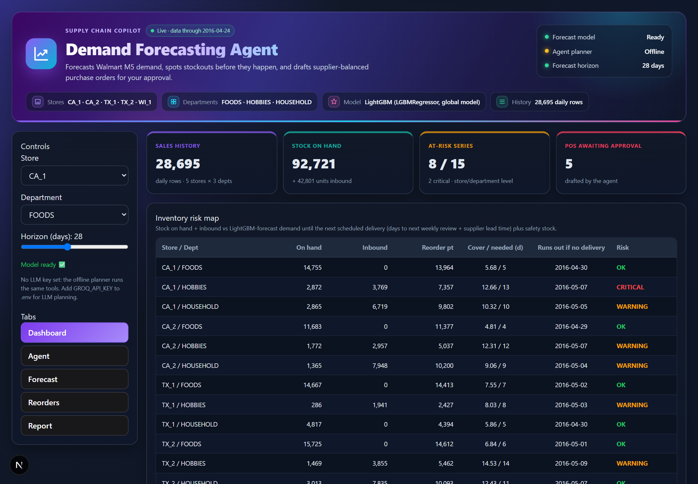

# Demand Forecasting Agent: Supply Chain Replenishment

This agent forecasts store/department demand on Walmart **M5** data with **LightGBM**. It
detects series that will run out before their next scheduled delivery and explains why, using
promotions, demand spikes and Google Trends. It then sizes expedite orders, splits them across
suppliers, and drafts purchase orders for a human to approve.

Read **[docs/REPORT.md](docs/REPORT.md)** (or the PDF, [docs/REPORT.pdf](docs/REPORT.pdf)) for the
full write-up: problem, workflow, model, evaluation with charts, UI screenshots, a 5-minute demo
walkthrough and the AI tools used. [docs/ARCHITECTURE.md](docs/ARCHITECTURE.md) covers the
components.



## Highlights
- **ML tool:** a global LightGBM model with SNAP-promotion and event features, forecast
  recursively. In a 3-window, 28-day chronological backtest it reaches **9.5% WAPE**, against
  13.4% for seasonal-naive and 32.4% for naive.
- **Agentic workflow:** "Plan replenishment" runs a risk scan, then for each at-risk series it
  runs forecast → promo calendar → spike check → external trend → supplier-allocated draft PO.
  Every tool call is shown in a reasoning trace.
- **Planners:** an LLM with tool calling (Groq, OpenAI or Ollama) when a key is set, otherwise
  an offline planner that uses the same 9 tools.
- **Human in the loop:** POs are created as drafts and approved or rejected in the UI. Approved
  quantities become inbound stock.
- **UI:** a Next.js dashboard with a risk map, agent chat, forecast bands, reorders, PO approval
  and a generated report.

## Quickstart
```bash
pip install -r requirements.txt
cp .env.example .env          # optional: add GROQ_API_KEY (free) for the LLM planner
python scripts/train.py       # trains LightGBM + runs the backtest (~1-2 min)

# Terminal 1 - backend
python -m uvicorn src.api:app --port 8000

# Terminal 2 - frontend
cd frontend && npm install && npm run dev
```
Then open http://localhost:3000. The API listens on http://localhost:8000. Set
`NEXT_PUBLIC_API_URL` if you run the backend somewhere else.

## Data
- The processed M5 store/department table (`data/supply_chain_sales.csv`) and the future M5
  calendar (`data/m5_calendar_future.csv`) are committed, so the app runs without the raw
  download.
- To rebuild from raw data, place the Kaggle M5 `sales_train_validation.csv` and `calendar.csv`
  files in `data/raw/m5/`, then run `python scripts/train.py`.
- M5 has no inventory or supplier data. On-hand and inbound stock come from replaying a
  static weekly ordering policy over actual sales. Supplier lead times, costs and reliability are
  documented assumptions. See the report for details.

## Tests
```bash
pytest -q
```
48 tests cover the risk boundaries, supplier allocation, PO idempotency and approval, agent
intent routing, horizon parsing, the end-to-end replenishment workflow, a mocked LLM tool
loop, backtest leakage and the trend fallback. Each test uses its own temporary SQLite database.

## Project layout
```
src/            data, model, eval, inventory, trends, tools, agent, db, api, report
frontend/       Next.js dashboard
scripts/        train.py (model + backtest), plot_accuracy.py, build_report_pdf.py
data/           processed M5 table, future calendar
reports/        backtest metrics + predictions
docs/           REPORT.md, ARCHITECTURE.md
tests/          pytest suite
```

## AI tools leveraged
OpenCode (Claude) and Claude Code (Claude Opus) for development, review and fixes. LightGBM,
pandas, pytrends, FastAPI and Next.js for the system itself. Groq, OpenAI or Ollama LLMs serve
as the optional agent planner. See section 10 of the report.
