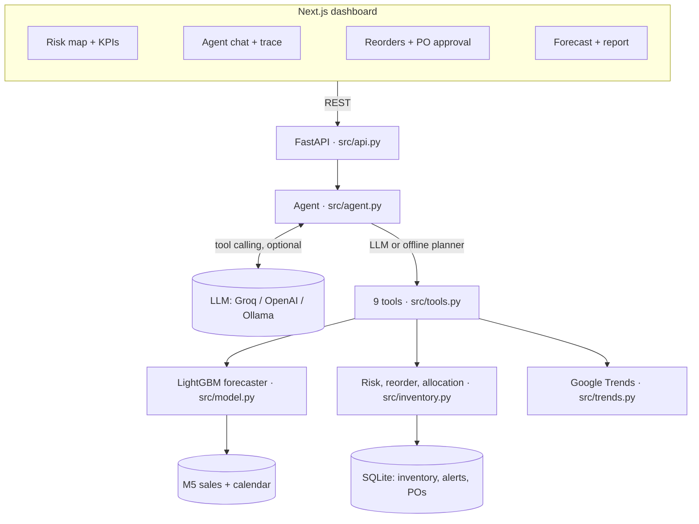
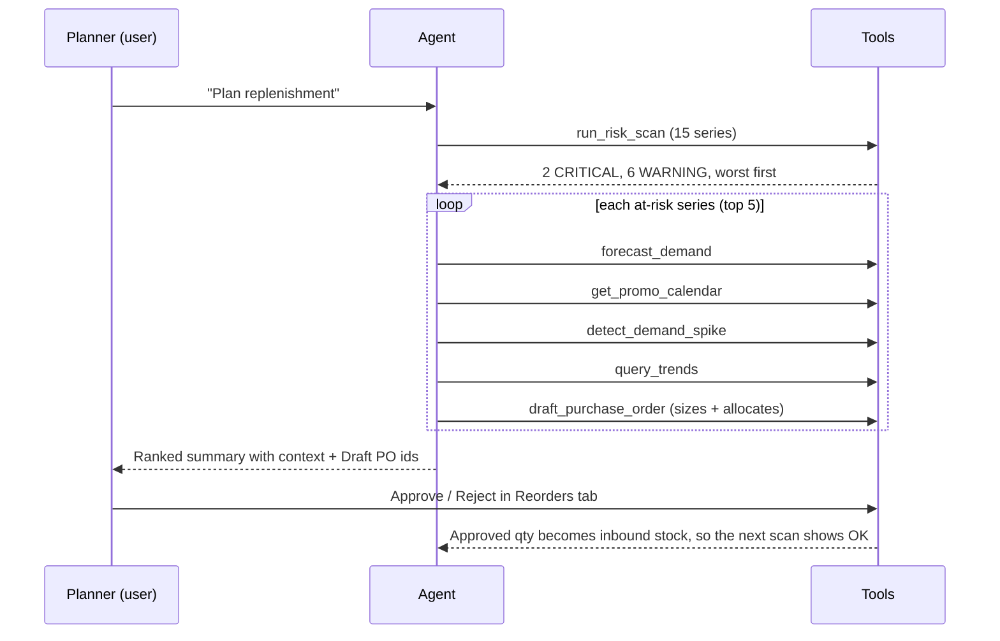
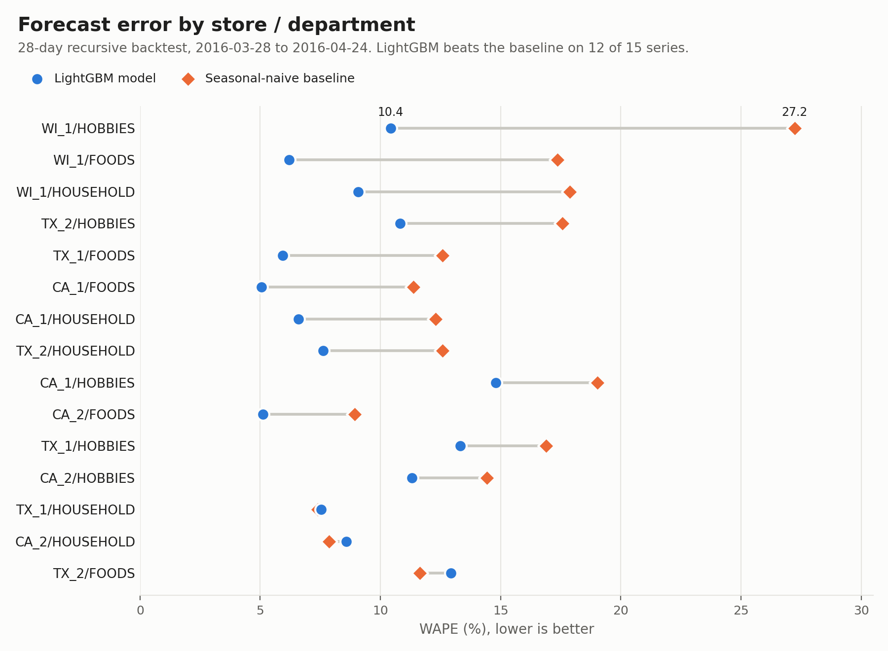
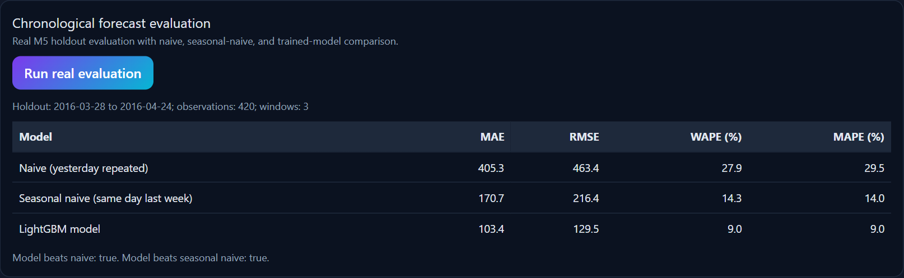
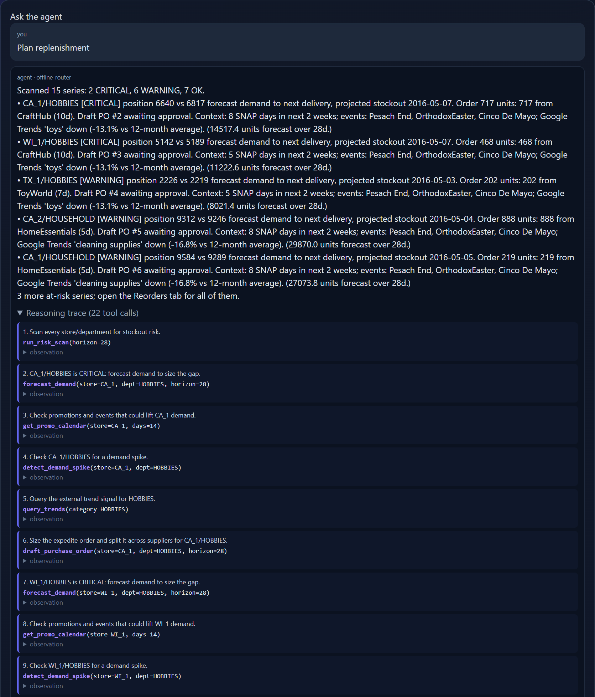
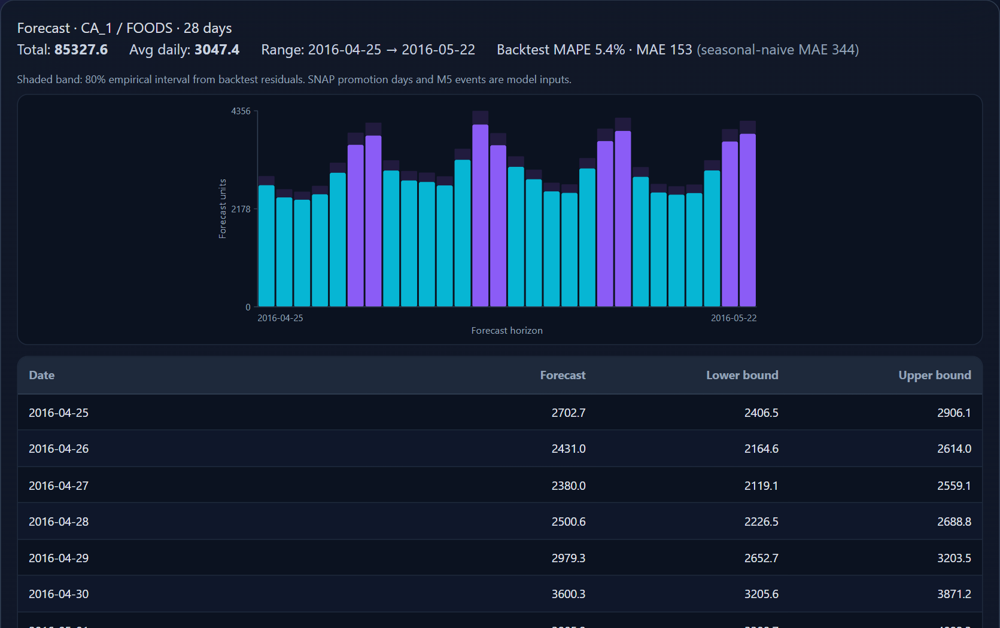
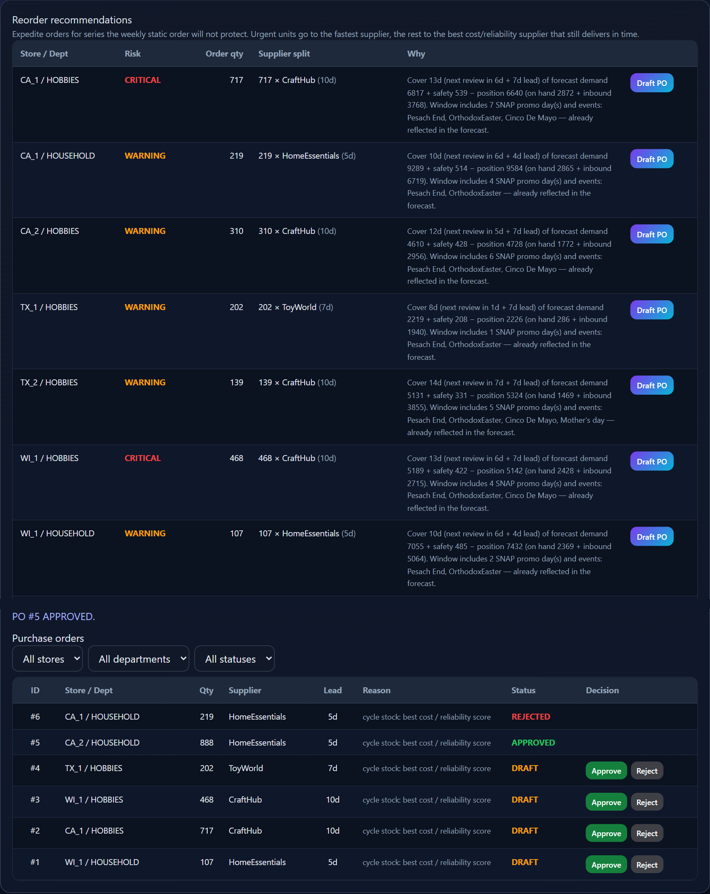

# Demand Forecasting Agent: Report

Latentsig review assignment, problem statement 2 (Demand Forecasting Agent Workflow).

## 1. The business problem

A retail supply chain re-orders stock on a fixed weekly cycle using a static rule: each week,
order enough to cover the next review period and the supplier lead time at the recent average
sales rate. This is the "traditional static system" the brief describes. It has three blind spots:

1. **It looks backwards.** A trailing average does not see SNAP benefit days, holidays or
   promotions that are already on the calendar.
2. **It has no safety buffer.** Normal demand variability and short supplier shipments
   cause stockouts. Replaying this policy over the real M5 sales history runs a series out of
   stock on **2.4% of days**.
3. **It needs a planner to catch problems.** Someone has to check 15 store/department series
   every day, decide which ones need an extra order and split that order across suppliers.

The agent automates that daily check. It forecasts demand with an ML model, finds the series
that will run out before the next scheduled delivery, explains why (promotions, spikes, external
trends), sizes an expedite order, splits it across suppliers, and drafts purchase orders for a
human to approve.

## 2. Requirement coverage

| Brief asks for | Where it is |
|---|---|
| ML tool: LightGBM or Prophet on M5 / Walmart | `src/model.py`: global **LightGBM** model trained on **Kaggle M5** sales |
| Detect sudden stockout risks | `detect_stockout_risk`, `run_risk_scan` (`src/inventory.py`) |
| Detect demand spikes | `detect_demand_spike`: last 7 days *and* next 7 forecast days vs a 90-day baseline |
| Query external trend data | `query_trends`: live Google Trends via `pytrends`, cached, honest "unavailable" fallback |
| Query promotional schedules | `get_promo_calendar`: SNAP days and retail events from the M5 calendar (56 days ahead) |
| Recommend automated re-orders | `recommend_reorder` and `draft_purchase_order`, with human approval in the UI |
| Supplier allocations | `allocate_suppliers`: urgent units go to the fastest supplier, the rest to the best cost/reliability supplier that can still deliver in time |
| Report on architecture and workflow | this document and `docs/ARCHITECTURE.md` |
| Bonus: UI/UX to run the agent | Next.js dashboard (`frontend/`): risk map, agent chat with reasoning trace, forecast chart, reorders and PO approval, report |
| AI tools used | Section 10 |

## 3. Architecture



**Planners.** With an API key (Groq is free) the LLM chooses the tools using OpenAI-compatible
function calling, for up to 8 tool steps. Without a key, an offline planner detects the intent
and runs fixed multi-step plans with the same tools. Either way, every call appears in the
UI's reasoning trace with its thought, arguments and full observation.

## 4. The agentic workflow ("Plan replenishment")



Example output (offline planner, real data):

> **CA_1/HOBBIES [CRITICAL]** position 6640 vs 6817 forecast demand to next delivery,
> projected stockout 2016-05-07. Order 717 units: 717 from CraftHub (10d). Draft PO #1 awaiting
> approval. Context: 8 SNAP days in next 2 weeks; events: Pesach End, OrthodoxEaster, Cinco De
> Mayo; Google Trends 'toys' down (-14.4% vs 12-month average).

The loop closes: approving the drafted orders adds them to inbound stock. In testing, approving
the five drafts moved the portfolio from 8 at-risk series (2 critical) to 3 (0 critical), and the
next run of the agent picked up the remaining three.

## 5. Data

* **Source:** Kaggle *M5 Forecasting – Accuracy* (`sales_train_validation.csv`, `calendar.csv`).
  Item-level sales are aggregated to **5 stores × 3 departments = 15 daily series**,
  2011-01-29 to 2016-04-24 (28,695 rows).
* **Calendar features:** SNAP days (per state) as the promotion flag, and M5 events as the
  holiday flag. The calendar runs 56 days past the last sales day, so these inputs are
  genuinely known for the whole forecast horizon. They are saved to `data/m5_calendar_future.csv`
  so a fresh clone works without the raw M5 download.
* **Not in M5 (documented assumptions):**
  * *Inventory.* We replay the static weekly policy from Section 1 over actual sales. Each
    store reviews on its own weekday, and orders arrive after the supplier lead time. Shipments
    are short (40–90%) with probability 1 − supplier reliability. This produces on-hand stock,
    inbound stock and days-to-next-review for every series.
  * *Suppliers.* Two per department, each with a lead time, relative unit cost and on-time
    reliability (`src/data.py`). Faster suppliers are more expensive.

## 6. Forecasting model (the ML tool)

* **LightGBM** `LGBMRegressor`: one global model over all 15 series, 400 trees, learning rate
  0.05, 31 leaves.
* **Features:** store, department, day of week, month, SNAP promotion, event/holiday, lags of
  1, 7 and 28 days, and 7- and 28-day rolling means.
* **Recursive multi-step forecasting:** each predicted day feeds the next day's lags. Training
  and serving use the same function (`recursive_forecast`), so the backtest measures exactly
  what the app serves.
* **Prediction intervals:** an 80% empirical band per series, from the 10th and 90th
  percentiles of actual/forecast ratios in the backtest. These are real multi-step errors, not a
  fixed ± percentage.

### Evaluation: chronological backtest, 28-day horizon, 3 rolling origins

Every window is trained only on data before its test start, and future sales are never used as
inputs (`src/eval.py`, `reports/backtest_metrics.json`). Metrics are macro averages over the
15 series.

| Window (test period) | Naive MAE / WAPE | Seasonal-naive MAE / WAPE | **LightGBM MAE / WAPE** |
|---|---|---|---|
| 2016-03-28 → 04-24 | 405.3 / 27.9% | 170.7 / 14.3% | **103.4 / 9.0%** |
| 2016-02-29 → 03-27 | 461.2 / 36.5% | 150.8 / 12.8% | **129.6 / 10.8%** |
| 2016-02-01 → 02-28 | 424.4 / 32.9% | 168.5 / 13.0% | **95.6 / 8.6%** |
| **Mean** | 430.3 / 32.4% | 163.4 / 13.4% | **109.5 / 9.5%** |

LightGBM cuts error by about 30% compared with the seasonal-naive baseline, and wins in all
three windows. Per series it wins on 12 of 15. It loses narrowly on CA_2/HOUSEHOLD and
TX_1/HOUSEHOLD, and on TX_2/FOODS (12.9% vs 11.6% WAPE), which is the first thing to
investigate next. HOBBIES is the hardest department (10–15% WAPE): it has low volume and
higher noise.



*Most recent 28-day window. Each row is one series; the grey bar is the error gap between the
baseline (orange diamond) and LightGBM (blue circle). The bottom three rows are the series
where the baseline is slightly better. Regenerate with `python scripts/plot_accuracy.py`.*

The same results as they appear in the app's Report tab:



## 7. Risk, reorder and allocation logic

Because the store orders weekly, stock has to last until the order placed at the next review
arrives. This window is the *protection interval*.

```
inventory_position = on_hand + on_order
protection_days    = days_to_next_review + supplier_lead_time
protection_demand  = Σ LightGBM forecast over protection_days
safety_stock       = z · σ_daily · √protection_days
reorder_point      = protection_demand + safety_stock

CRITICAL  position < protection_demand    → runs out before the next scheduled delivery
WARNING   position < reorder_point        → will dip into safety stock
OK        otherwise
```

Here z = 1.65 targets about a 95% cycle service level, and σ_daily is estimated from
week-over-week changes in sales, so the regular weekly pattern doesn't inflate it.

* **Expedite quantity:** `reorder_point − position`, rounded up. This tops the series back up so
  the routine weekly order takes over again. OK series get no order.
* **Supplier split:** units needed before even the fastest supplier can deliver go to the
  fastest supplier. The remainder goes to the supplier with the best unit cost ÷ reliability
  score, provided its lead time still fits the protection interval.
* **Purchase orders** are created as `DRAFT` with an idempotency key, so re-running the agent
  never duplicates them. Only a person can mark them `APPROVED` or `REJECTED`, and approved
  quantities become inbound stock.

## 8. UI/UX

A Next.js 16 + FastAPI app. All screenshots are from the running app on real M5 data.

### Dashboard
KPI cards, model and planner status, and a risk map for all 15 series: on hand, inbound,
reorder point, days of cover vs days needed, and the date stock runs out with no delivery.
Below it sit a risk feed with a one-click "Ask the agent to plan replenishment" button, a live
Google Trends widget, and a recent-demand chart.


### Agent
Chat with suggestion chips. Every answer has an expandable reasoning trace showing each
step's thought, the tool called with its arguments, and the full observation. Here, "Plan
replenishment" runs 22 tool calls across the at-risk series.



### Forecast
A 7–56-day forecast. The darker cap on each bar is the empirical 80% upper band; the
backtest error for this series appears next to the seasonal-naive baseline. Moving the horizon
slider shows an "Updating forecast" overlay until the new forecast arrives.



### Reorders and purchase-order approval
Expedite recommendations with the supplier split and a full rationale, then the purchase
orders the agent drafted, which a planner approves or rejects. (The eight OK series, which
need no order, are trimmed from this image.)



## 9. Demo walkthrough (5 minutes)

1. **Start it:** `python -m uvicorn src.api:app --port 8000`, then `npm --prefix frontend run dev`,
   and open http://localhost:3000.
2. **Dashboard:** the risk map shows which series run out before their next delivery
   (2 CRITICAL, 6 WARNING on the M5 data).
3. **Agent:** click "Plan replenishment". Open the reasoning trace to see the agent scan, forecast,
   check promotions, spikes and Google Trends, then draft supplier-split POs.
4. **Reorders:** approve the drafted POs. Back on the Dashboard, the at-risk count drops, because
   approved quantities become inbound stock.
5. **Forecast and Report:** change the horizon to see the forecast and its 80% band. The Report
   tab shows the backtest against both baselines and a downloadable supply-chain report.

Optional: put a free `GROQ_API_KEY` in `.env` and restart the backend. The same questions are
then planned by an LLM choosing the tools itself.

## 10. AI tools leveraged

* **OpenCode (Claude):** scaffolding, refactoring and code review during the build.
* **Claude Code (Claude Opus):** a requirements review and bug-fix pass. It ran the app end to
  end, then switched to LightGBM, added forecast-driven risk, supplier allocation, the promotion
  calendar, the replenishment workflow, human PO approval, input validation and test isolation.
* **LightGBM, scikit-learn (metrics), pandas, NumPy, pytrends, FastAPI, Next.js.**
* **LLM planner (optional):** Groq `llama-3.3-70b-versatile` (free tier), OpenAI `gpt-4o-mini`, or a
  local Ollama model, all through the OpenAI-compatible client.

## 11. Limitations and next steps

* Inventory and supplier data are simulated or assumed, because M5 has none. A real deployment
  would read on-hand and inbound stock from the WMS/ERP. The risk engine only needs those
  inputs.
* The work is at store/department level. Item-level forecasting (M5's 30k series) would need
  LightGBM with item embeddings or hierarchical reconciliation.
* Google Trends is a weak, US-wide signal. It is reported as context, not used to change order
  quantities.
* Next steps: price features from `sell_prices.csv`, quantile LightGBM for intervals, a fix for the
  TX_2/FOODS underperformance, ERP/email export of approved POs, and scheduled daily scans.
